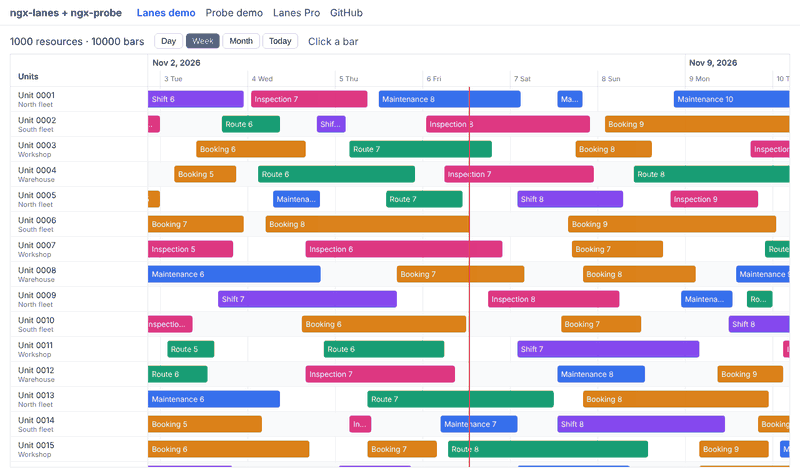

# ngx-lanes + ngx-probe

Two open-source tools for Angular apps that handle a lot of data.

| Package | What it does | |
| --- | --- | --- |
| [**ngx-lanes**](projects/lanes) | Resource timeline: rows are resources, bars are assignments in time. Virtualized, so 1,000 rows and 10,000 bars stay smooth. | [Demo](https://dmartinezzm.github.io/ngx-lanes/) |
| [**ngx-probe**](projects/probe) | Runtime performance probe: slow change detection, leaking RxJS subscriptions, duplicate HTTP requests and unvirtualized lists. | [Demo](https://dmartinezzm.github.io/ngx-lanes/errors) |



Both work with Angular 19 or later, zoneless or with zone.js.

## Quick start

```bash
npm install ngx-lanes
npm install --save-dev ngx-probe
```

See each package's README for usage: [ngx-lanes](projects/lanes/README.md) · [ngx-probe](projects/probe/README.md).
Try ngx-lanes without installing anything: [StackBlitz example](https://stackblitz.com/github/dmartinezzm/ngx-lanes/tree/main/examples/basic).

## Lanes Pro

Drag and drop, canvas rendering, conflict detection, live updates and export are coming in Lanes Pro. [Join the waitlist](https://dmartinezzm.github.io/ngx-lanes/pro).

## Development

```bash
pnpm install
pnpm ng build lanes && pnpm ng build probe   # the demo imports them from dist/
pnpm start                                    # demo at http://localhost:4200
pnpm ng test lanes --watch=false
pnpm ng test probe --watch=false
```

If you change a library while `ng serve` is running, rebuild it and restart the server.

| Folder | Contents |
| --- | --- |
| `projects/lanes` | ngx-lanes source and tests |
| `projects/probe` | ngx-probe source and tests |
| `projects/demo` | Demo app deployed to GitHub Pages |
| `examples/basic` | Minimal app that installs ngx-lanes from npm (StackBlitz) |
| `.github/workflows` | CI, demo deployment and npm publishing |

### Releasing

1. Bump `version` in `projects/lanes/package.json` and `projects/probe/package.json` (both use the same version).
2. Create a GitHub release with the tag `v<version>`, for example `v0.1.0`.
3. The **Publish to npm** workflow runs the tests, builds and publishes both packages with provenance through npm trusted publishing (no tokens). Each package must list this repository and `release.yml` as its trusted publisher on npmjs.com.
4. The versions are staged, not published: approve them on npmjs.com → Staged Packages (2FA required).

## License

MIT
