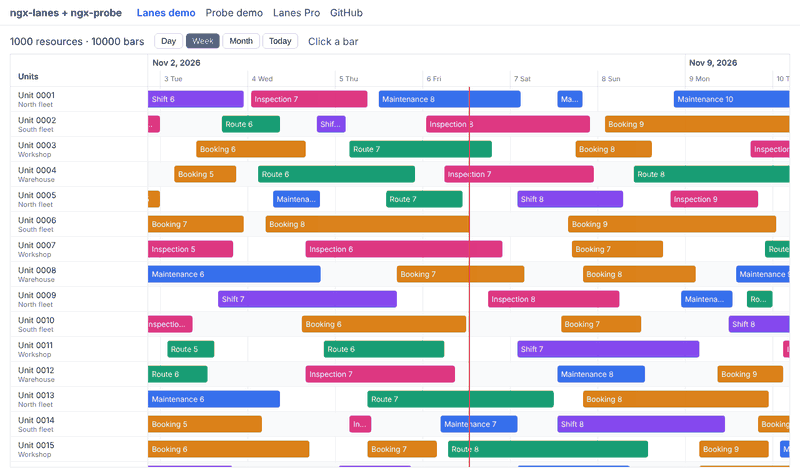

# ngx-lanes

**Resource timeline for Angular.** Each row is a resource (a person, vehicle, room, machine…) and each bar is an assignment in time. Only what is on screen is rendered, so thousands of rows and tens of thousands of bars stay smooth.

[Live demo](https://dmartinezzm.github.io/ngx-lanes/) · [GitHub](https://github.com/dmartinezzm/ngx-lanes)



- **Virtualized in both directions:** with 1,000 resources and 10,000 bars the DOM holds about 22 rows and 50–130 bars at any time.
- **Fast range lookups:** bars are indexed per resource and found by binary search, not scanned.
- **Modern Angular:** standalone, signal inputs, `OnPush`, works with zoneless and with zone.js. Angular 19 or later.
- **Day, week and month zoom** that keeps the same instant centred.
- **Accessible bars:** real buttons with a label that includes the resource and the dates.
- **Themeable** with CSS variables.

## Install

```bash
npm install ngx-lanes
```

## Usage

```ts
import { Component, signal } from '@angular/core';
import { LanesTimeline, LanesItem, LanesResource, LanesZoom } from 'ngx-lanes';

@Component({
  selector: 'app-planning',
  imports: [LanesTimeline],
  template: `
    <lanes-timeline
      style="height: 600px"
      [resources]="resources"
      [items]="items"
      [(zoom)]="zoom"
      (itemClick)="open($event.item)"
    />
  `,
})
export class Planning {
  resources: LanesResource[] = [{ id: 'v1', label: 'Van 1', description: 'North fleet' }];
  items: LanesItem[] = [
    { id: 'a1', resourceId: 'v1', start: '2026-11-06T08:00', end: '2026-11-06T14:00', label: 'Route 3' },
  ];
  zoom = signal<LanesZoom>('week');

  open(item: LanesItem) {
    console.log(item);
  }
}
```

## API

| Input | Type | Default |
| --- | --- | --- |
| `resources` | `LanesResource[]` | required |
| `items` | `LanesItem[]` | `[]` |
| `zoom` (two-way) | `'day' \| 'week' \| 'month'` | `'week'` |
| `start`, `end` | `Date \| number \| string` | items' range ± 1–2 days |
| `rowHeight` | `number` (px) | `40` |
| `resourceWidth` | `number` (px) | `220` |
| `resourceHeader` | `string` | `'Resources'` |
| `showToday` | `boolean` | `true` |
| `locale` | `string` | `LOCALE_ID` |

Outputs: `itemClick`, `itemDoubleClick` — `{ item, resource, event }`.
Methods: `scrollToTime(date)`, `scrollToResource(id)`.

## Theming

Set these CSS variables on `lanes-timeline`: `--lanes-bg`, `--lanes-border`, `--lanes-grid`, `--lanes-text`, `--lanes-text-muted`, `--lanes-bar-bg`, `--lanes-bar-text`, `--lanes-bar-radius`, `--lanes-today`, `--lanes-row-alt-bg`, `--lanes-header-height`, `--lanes-font`.

## Lanes Pro

Drag and drop between resources, canvas rendering, conflict detection, live updates from SignalR or WebSockets, and PNG/PDF/Excel export are coming in **Lanes Pro**. [Join the waitlist](https://dmartinezzm.github.io/ngx-lanes/pro).

## License

MIT
