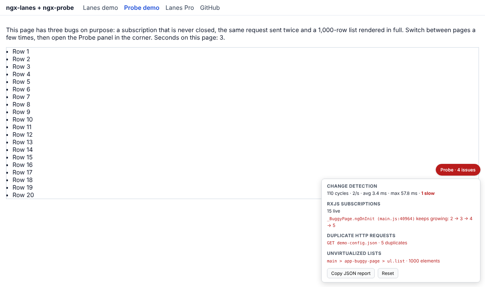

# ngx-probe

**Runtime performance probe for Angular.** An AI assistant can read your code, but it cannot watch your app run with real data. Probe does, and points at the line to fix:

- **Change detection:** cycles per second, average and worst duration, slow cycles (over 16 ms).
- **Leaking RxJS subscriptions:** counts live subscriptions by the line that created them and flags the ones that grow on every visit to the same page.
- **Duplicate HTTP requests:** identical GET/HEAD requests in flight at the same time or repeated within 1 s.
- **Unvirtualized lists:** elements with 300 or more direct children.

[Live demo](https://dmartinezzm.github.io/ngx-lanes/errors) · [GitHub](https://github.com/dmartinezzm/ngx-lanes)



## Install

```bash
npm install --save-dev ngx-probe
```

## Usage

```ts
// app.config.ts
import { provideHttpClient, withInterceptors } from '@angular/common/http';
import { probeHttpInterceptor, provideProbe } from 'ngx-probe';

export const appConfig: ApplicationConfig = {
  providers: [
    provideRouter(routes),
    provideHttpClient(withInterceptors([probeHttpInterceptor])),
    provideProbe(), // on in dev mode only
  ],
};
```

A panel appears in the bottom-right corner. Get the JSON report with the **Copy JSON report** button or `window.__probe.report()` in the console. The report is plain JSON, so you can paste it into your AI assistant and ask for the fix.

## Options

`provideProbe({ ... })` accepts `enabled` (dev mode), `overlay` (true), `slowTickMs` (16), `largeListThreshold` (300), `duplicateWindowMs` (1000), `leakSnapshots` (3), `snapshotDelayMs` (800), `scanIntervalMs` (2000) and `console` (true).

## Limits

- **Development and staging only.** It patches `Observable.prototype.subscribe` and Angular's internal `ApplicationRef._tick`, which may change between major versions.
- Leak origins point at the bundle (`main.js:689`), not your `.ts` file, until source map support lands.
- Works with Angular 19 or later, zoneless or with zone.js.

## License

MIT
